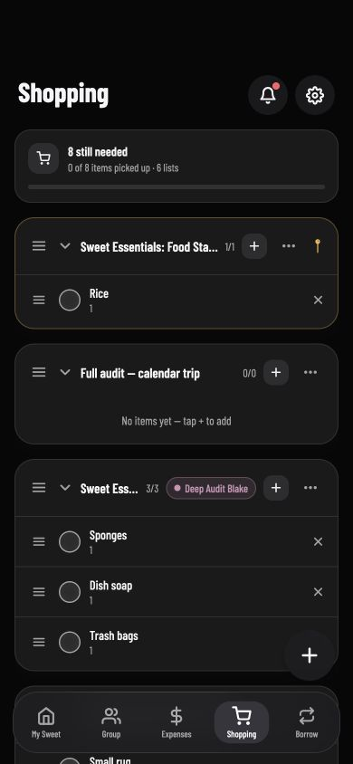
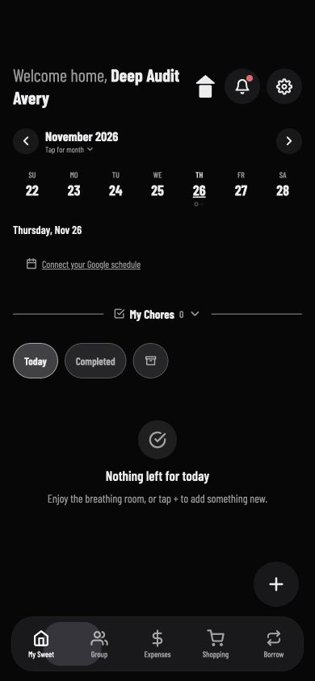

# SweetMate action audit — November 26, 2026

This audit found and corrected **five functional defects**, a browser accessibility-state defect, and a gap in the default test runner. It does **not** establish that every possible action, device, account state or network condition is bug-free. In particular, the owner's exact calendar rendering problem on physical iPhone/TestFlight 1.0.0 (54) is still awaiting native-device verification.

The audited source is on canonical `main` in `Downloads/Homie2-main`, based on `51a48e8`. No EAS build, native installation, TestFlight upload or production backend change was performed. Build 54 remains unchanged.

## Evidence and scope

- **347 control source locations, 27 Modal declarations and 22 popup call sites** inventoried across app routes and components. These are source locations, including shared components and dynamically repeated controls, not 347 independently tapped buttons.
- **59 live scenario observations** in two independent Chrome sessions against real local Supabase, including initial failures and their retests: 51 pass observations, 6 historical failures now corrected, and 2 explicitly superseded premature observations. This is not a pass percentage for the entire app.
- **92/92 mobile test programs pass**, plus repository typechecking. The programs include pure-function tests, source contract assertions, controlled executions of actual hooks/components/callbacks, and orchestration tests. They are not 92 native end-to-end tests.
- **8/8 real local PostgreSQL rollback suites pass**, plus a two-connection random-task concurrency test. A separate embedded PostgreSQL chore obligation/migration regression also passed.
- Expo exports compiled for **web, iOS Hermes and Android Hermes** using local QA configuration. Compilation is not an installed-device test or an Xcode archive.
- Normal desktop layout and one verified **390 × 844 CSS-pixel browser viewport** were observed. The viewport override was reset afterward.

[Per-location source inventory](full-action-inventory-2026-11-26.csv) · [Inventory and live observation ledger](full-action-audit-2026-11-26.json)

The sole inventory entry without a conventional press callback was `PreferenceBar`; review confirmed that it uses its gesture/change and accessibility adjustment callbacks. All 27 Modal declarations have an `onRequestClose` callback. These structural checks do not prove that every native hit target or modal transition responds correctly.

## Corrected defects

| Defect and reproduced trigger | Correction | Verification |
| --- | --- | --- |
| Finish today's only chore; My Progress changes to 0/0 instead of 1/1. | Keep chores completed on the current household day in the progress total; skipped and prior-day completions remain excluded. | Actual home-screen fixture checks completion, undo and day boundaries; live Blake shows 1/1 after reload. |
| Add a custom planner task while an older shared-household snapshot arrives; the field clears but the task disappears. | Per-task versions and deletion tombstones merge local intent with remote snapshots and survive cached restore. Explicit local edits cannot be swallowed by remote-echo suppression. | Controlled actual-hook/context tests cover concurrent additions, deletion replay and scope reset. A pre-add snapshot was replayed through authenticated local REST; the task stayed, reached Blake, survived reload and remained in the database. |
| Essentials reports 7 added across 4 lists, but reopening shows empty lists and the database has zero child items. | Child writes await confirmed parent-list writes. Transfer success and analytics wait for both collections to persist; failures reject and retain retryable intent. | Old hook fails an enforced-foreign-key timing fixture. Corrected hook passes delayed-parent, failure/retry and scope-change tests. Actual context callback confirms that success waits. Live transfer saves 8 child items across 5 lists, including a new parent; duplicate retry adds zero; both members and reload retain all 8. |
| Reload Chore Chart directly, then press Back; no previous navigation entry exists and nothing happens. | Back actions use an explicit fallback when history is absent: planning/difficulty to Settings, Settings/Alerts/setup exit to app tabs. Existing history still uses Back. | Navigation and actual setup-route fixtures; live refreshed creator returns to Settings and refreshed Settings closes to My Sweet after session hydration. |
| Pin or reorder Shopping lists/items with another roommate connected; the order reverts after reload. | Retain per-row saved ranks through partial realtime batches; explicit local moves update ranks. Incoming rows reorder peers without turning an incomplete batch into a new write. Legacy pinned rows load in the pinned partition. | Old hook fails a two-client order regression. Corrected list and item tests cover peer sync/reopening without echo loops. Live Kitchen/Room and Sponges/Dish soap ordering reaches Blake and survives both reloads; pinned Food Staples remains first. |
| Browser checkbox/radio/accordion states are visually selected but omit checked/expanded state. | Add explicit web ARIA checked/expanded props alongside native accessibilityState on affected controls. | Live chore/shortlist checkboxes, generated difficulty/frequency radios and settings accordions expose their current state. Full VoiceOver/keyboard coverage remains outside this audit. |

The default `test` command previously omitted `householdManagement.test.ts` and `nudgeDisplay.test.ts`. Both passed individually. The new runner discovers every `lib/**/*.test.ts`, executes each separately, reports all failures and returns a failing exit code if any program fails. New custom-task and navigation programs bring the total to 92.

A small setup-review copy correction also points returning members to Chore Chart for unsupported custom items, because that resumed setup screen does not contain a custom-chore editor below it.

## Action coverage by flow

| Area | Live actions verified | Controlled/structural checks and remaining gaps |
| --- | --- | --- |
| My Sweet and chores | Blank validation; create with details/recurrence/date; completion and Completed view; edit/reassign and peer visibility; progress; summary dismissal removes Calendar heading; Upcoming starts collapsed. | Day/night boundaries, schedule completion queue, completion feedback and calendar presentation have automated coverage. Physical scroll/swipe/haptic behavior unverified. Individual chore permanent deletion and all archive permutations were not executed. |
| Group and Random Task | Group/calendar filters, month/date selection, random-task validation, claim by peer removes board entry, random assignment and completion remove top entry. | Database checks enforce due dates, privacy and claim/draw rules; simultaneous claims and idempotent draws pass. Forced expiry is tested; an actual 24-hour wait and production push delivery are not. |
| Shopping | Blank list validation; list/item create, quantity and assignments; check/undo; pin, list/item reorder; confirmed list+child deletion; duplicate transfer; category transfer and peer/reload persistence; planned Nov 27 7:30 PM trip appears in Group calendar. | Native drag handles, keyboard/sheet interaction on iPhone and every catalogue item permutation were not physically exercised. |
| Expenses | Shopping handoff; equal/custom allocations; $24.60 save with $10/$14.60 shares; overpayment rejected; $5 partial repayment reduces $14.60 to $9.60; reversal, edit, settle/reopen, void/history/restore; linked IOU survives source-list deletion. | These are dummy bookkeeping entries, with no money transferred. Automated permissions/cents/idempotency/failure checks supplement the live cases. Every multi-payer/repayment combination is not exhaustive. |
| Borrowing | Self borrowing saves; invalid-date recovery; Other owner requires name; private entry hidden from peer; borrower request/owner return; owner undo; edit notes reach peer; specifically approved self-record deletion survives sync. | Calendar-day/DST and permissions tests supplement UI checks. Native date keyboard and arbitrary legacy-record combinations unverified. |
| Chore creator and approval | Help popup; generated task difficulty/frequency edit; slider keyboard endpoint saves; custom task save; permanent Always me/Never me; preview/pending member status; nine-week loop; Send starts both Pending; two approvals; creator success return; restart clears approvals and alerts peer; approval again from creator and Alerts. | Automated review/workload/rotation/retained-work and SQL activation tests pass. The recorded nine-week preview is one fixture, not every possible rotation horizon. Approval-triggered push on real devices unverified. |
| Household setup and management | Member edits existing home without losing roommates; Other type, room counts, custom item, chore rename/custom interval; skip after save. Create a second household, validate name, skip Essentials, finish/skip chart; Blake joins after blank/short-code validation; household/chart status are independent; switch back and restore original data. | Account/household/member deletion and actual leave/removal are not executed in browser. Confirmation dialogs open and cancel. Structural/SQL policy checks are not a replacement for production deletion testing. |
| Settings, privacy and help | Profile rename/save/restore; accordions; four accents; activity/house monitor; analytics/crash switches restored off; invite-copy confirmation; Quick Guide dismiss; feedback required-field/email errors and cancel; Read all clears unread markers. | Local telemetry vendor keys are blank. No feedback was sent. Native photos, share sheet, notification permission and actual telemetry delivery were not tested. |
| Authentication | Sign out; invalid-email validation; existing local QA email/password sign-in restores Blake and saved household. | Google/Apple OAuth, new-account legal consent/email delivery, credential changes and account deletion were not completed. No real password was changed. |
| Navigation and exceptional states | Five regular tabs and normal nested navigation; direct-reload Chore Chart and Settings exit after hydration. | Hidden-tab normalization/last-visible protection, nudge dismissal contracts, shared Add-button recovery and error-fallback controls execute in controlled tests. Tab long-hold/drag hide and restore, disabled points/leaderboard flows, actual crash/restart and native back gestures were not live-tested. |
| Imported Google schedule | Connect entry points are present; local launcher path inspected. | Actual picker/callback behavior is exercised with substitutes; Calendar/task completion and isolation are checked in automated/SQL tests. No real Google consent, token refresh, live import, external task mutation or revoke/disconnect was verified during this audit. Do not infer that the local launcher attempt proves a working production connection. |

## Backend validation

All of these passed against real local PostgreSQL inside rollback transactions:

1. `unchanged_chore_updates.sql`
2. `replacement_chore_anchors.sql`
3. `personal_event_completion.sql`
4. `random_tasks.sql`
5. `household_schedule.sql`
6. `personal_schedule.sql`
7. `restart_chore_chart_review.sql`
8. `borrowing_owner_sources.sql`

`random_tasks_concurrency.mjs` also passed with independent simultaneous connections. The embedded PostgreSQL `single_chore_obligation.test.mjs` passed. An initial embedded all-suite harness could not run the random-task cron registration assertion because its simulated environment lacked `cron.job`; the real PostgreSQL run supplied pg_cron and passed all eight suites. That harness limitation was not an app defect.

## Limitations and unresolved verification

1. **Physical iPhone/TestFlight 54:** no connected iPhone or Xcode simulator was available. Browser success and native bundle compilation do not verify the calendar header animation in the owner's installed build. Saved compact-mode handling and header remounting were corrected in the preceding calendar fix, but exact phone behavior remains unconfirmed. No new release was authorized.
2. **OS-dependent interactions:** haptics, native long presses, drag/reorder gestures, swipe velocity, keyboard avoidance, iOS safe areas, Reduce Motion/large text/VoiceOver, photo permissions, push permission/delivery, share sheets and app lifecycle transitions require device testing. Browser warnings explicitly fall back from some native animation/easing paths.
3. **External providers:** real Google/Apple authorization, Calendar/Tasks servers, email, production rate limits and telemetry delivery were not exercised. The public privacy URL returned HTTP 200, which establishes reachability only, not policy completeness or legal adequacy.
4. **Destructive scope:** only the specifically approved dummy grocery list/test milk and self-borrow record were permanently deleted through UI. Account deletion, household deletion, leaving and removing a real member were not executed. Additional isolated QA records remain available for retests.
5. **State/concurrency limits:** two local members and selected stale/delayed/failed-write cases were tested. Offline airplane mode, process termination during every save, intermittent realtime loss, very large households, all timezones/DST transitions and mixed old/new app versions are not exhaustively covered. Older clients that lack custom-task version metadata or the shopping-order fix may still overwrite newer intent.
6. **Inventory is not execution:** shared controls can render hundreds of instances, and conditionals expose more paths than one session can reach. Some tests assert source contracts or substitute native rendering and network boundaries. Neither a callback's presence nor a green test proves that every physical tap succeeds.
7. **Startup timing:** UI automation must wait for session/household hydration and sheet dismissal. Several immediate attempts during loading/dismissal did not target the final interactive screen. They were not accepted as successful actions or counted as confirmed defects without a stable-state reproduction.
8. **Release verification:** no new signed IPA was produced or installed. These fixes need the owner's next explicitly authorized native release, followed by a physical-device smoke test, before claiming the installed TestFlight behavior is corrected.

## Reproduction records and safety

Only fresh local QA users (Deep Audit Avery/Blake) and Comprehensive Audit Home / Full audit — second household were mutated. Existing user households and production records were preserved. Stale-state injection used the authenticated local REST API with a captured snapshot of that isolated household. Secrets and fixture passwords remain outside Git in a private temporary file.

The earlier Essentials success observation was explicitly superseded once reopening and a database query disproved it; the early reorder pass was likewise superseded. Both failures have subsequent live, peer and reload checks in the attached ledger. A success message alone is not treated as proof of persistence.

