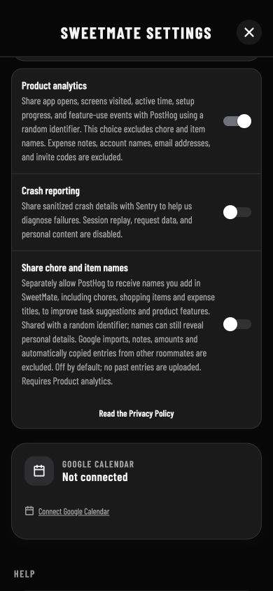
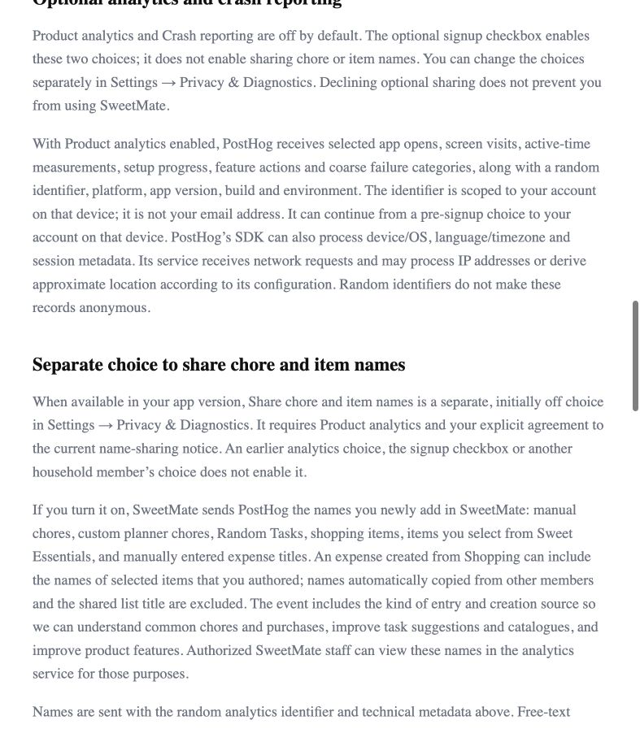

# Separate item-name analytics verification — November 26, 2026

Prepared on canonical main. The production gate is off, no real content was sent to PostHog, and no native build or TestFlight release was requested or performed.

## Passing checks

- Repository typechecking and **93/93 mobile test programs**.
- Actual vendor boundary with local SDK/storage substitutes: default-off release flag, separate/current name notice, previous consent remains content-free, no backfill after opt-in, immediate opt-out before storage resolves, same-account/revision checks, failed consent write, old notice, product off clears names, product re-enable leaves names off, one-shot callbacks and bounded label filtering. Generic metadata/Sentry content filtering remains intact.
- Actual Settings component fixture: dependency on Product analytics, independent name toggle, old notice displays off, crash renewal cannot revive older product/name consent, feature flag hides the control.
- Actual expense callback fixture: manual title only, Shopping conversion filters by author, excludes peer entries/list title, failed confirmed save does not report names.
- Local web export with an explicit **QA-only** name-sharing flag and **blank PostHog/Sentry keys**. The normal app configuration remains default-off.
- Chrome with the local dummy Avery account: Product analytics off → name control off/disabled; product on leaves names off; separate name toggle works; product off clears names; product back on leaves names off. Finished with all three choices off. New disclosure checked at a 390 × 844 CSS viewport; override reset afterward.
- Prepared privacy, support and deletion components rendered with real React SSR and a substituted Next Link. Required disclosure phrases and contact links checked. Privacy text was viewed in browser with a prominent local/unpublished banner.
- Existing live privacy URL returned HTTP 200 but **does not contain the new name-sharing notice**.

## Limits and publication blocker

The original Sites project still returns legacy readable metadata but `project_not_found` / 404 for source-write credentials. The checked-in website pages are prepared local source, not a published update. The normal full website framework build was not run: its authoritative hosted checkout is unavailable and local website dependencies are absent. The targeted SSR/visual check does not prove production routing, Cloudflare runtime or website deployment.

No vendor delivery, production dashboards, retention/IP/GeoIP settings, App Store Connect privacy answers, real-device accessibility/haptics, or native consent persistence were changed or verified. A browser preview with blank keys cannot establish production ingestion. Synthetic vendor-boundary tests are the evidence for captured event fields. Existing devices are unchanged; activation waits for policy/store readiness and a separately authorized native release.

See `docs/privacy/name-sharing-release-2026-11-26.md` for the remaining publication/activation steps. No DNS/hosting replacement or purchase was made.

